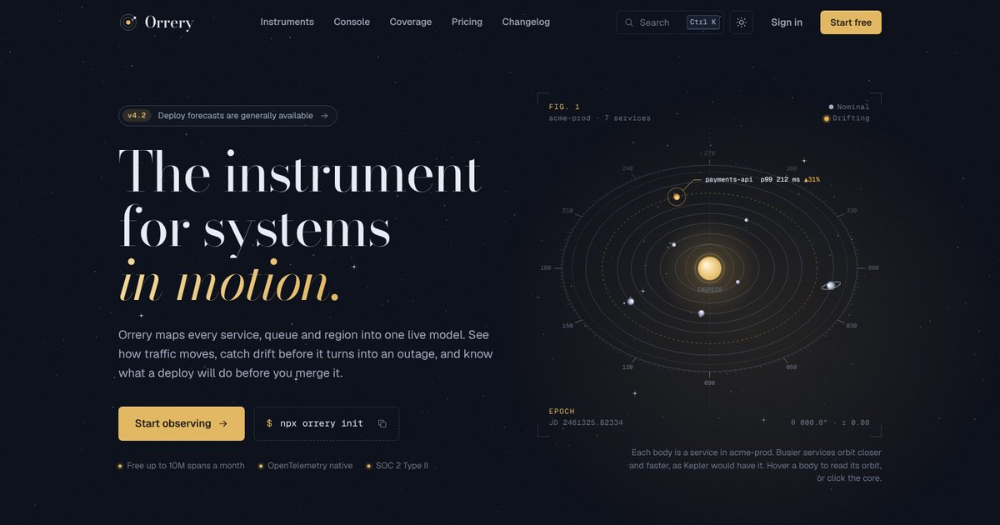

# Orrery

A landing page for **Orrery**, a fictional observability platform that draws your services as planets around an ingress core. It's a design concept, built to show how much craft a single static page can hold.



There's no framework and no build step. It's hand-written HTML, CSS and `<canvas>`, with zero runtime dependencies beyond Google Fonts.

## Run it

```sh
npx serve .          # or: python3 -m http.server
```

Then open the printed URL. Opening `index.html` straight from disk also works.

To publish on GitHub Pages: **Settings → Pages → Deploy from a branch**, then pick the branch and `/ (root)`. `404.html` is picked up automatically.

## What's on the page

| Section | What it does |
| --- | --- |
| **Hero orrery** | A canvas instrument plate. Seven services orbit an ingress core, with periods that follow Kepler's third law (T ∝ a^1.5). Requests fly out as brass particles and responses return in blue. Hover a body to read its orbital elements, move across empty space to get a measuring reticle (θ and r), and click the core for a flare. The hero tilts slightly with the pointer. |
| **Instruments** | A bento grid: a live service map (hover a node to trace its calls), a trace waterfall, a drift-alert sparkline against a learned baseline, a deploy forecast fan chart, an OQL snippet with a copy button, and integrations. Cards pick up a cursor spotlight on the surface and border. |
| **Live console** | Simulated traffic for six services: a streaming p50/p99 chart with an SLO line and breach bands, tiles, sparklines and an event log. You can switch services, change the window (15m, 1h, 24h), pause it, or type a query such as `service = "ledger" over 1h`. payments-api drifts past its SLO every so often, and the log opens and resolves alerts as it happens. |
| **Workflow** | Three real steps with a terminal that types each one out, then auto-advances with a progress bar. Supports arrow keys and has a replay button. |
| **Coverage** | An armillary-sphere globe with a graticule every 15°, an ecliptic ring at 23.4°, collector regions and great-circle packet arcs. Drag to spin it with inertia. Hovering a region row flies the globe there. |
| **Field reports** | An auto-advancing quote carousel that pauses on hover. |
| **Pricing** | A monthly/annual switch with animated prices, tiers aligned on a CSS subgrid, and a logarithmic bill estimator from 10M to 50B spans. |
| **Ephemeris** | The changelog, with every date also given as a Julian Day. |
| **Questions** | An exclusive accordion built on native `<details name>` that animates open with `::details-content`. |
| **Footer** | A live UTC clock and Julian Day, a three-way theme switch (system, light, dark), and an outlined wordmark whose letters lift on hover. |

## Small details

- **Command palette:** `⌘K`, `Ctrl K` or `/`. Fuzzy search with highlighted matches, grouped commands, and full keyboard control.
- **Shortcuts:** `?` lists them all. `T` toggles the theme, `M` pauses motion, `A` aligns the planets, and `G` then a letter jumps to a section (`G P` for pricing, `G G` back to the top).
- **Theme switch** grows from the button as a circular reveal (View Transitions API), and your choice is remembered.
- **Easter eggs:** type `syzygy` (or press `A`) to line up every planet. The Konami code triggers a total eclipse.
- A scroll-progress ring with an orbiting planet doubles as a back-to-top button.
- Section labels scramble in, counters roll up, primary buttons are magnetic, the logo's planets spin on hover, and the header hides on the way down and returns on the way up.
- The tab title changes while you're away. Open the dev-tools console for a note.

## Craft notes

- **Type:** Bodoni Moda for display, Geist for text, Geist Mono for data. The headline is sized with container query units so it always holds three lines.
- **Color:** brass on night-sky ink, with a star-chart-paper light theme. Every color is a token on `:root`, redefined for light under `prefers-color-scheme` and `[data-theme]`.
- **Motion:** scroll reveals are pure CSS scroll-driven animations, so content stays fully visible wherever they aren't supported. Every canvas pauses when it's off screen or the tab is hidden. `prefers-reduced-motion` and the page's own `M` toggle both stop ambient motion.
- **Accessibility:** skip link, landmarks, labelled canvases, real `<dialog>` modals, ARIA tabs, switch and radio groups with arrow-key support, visible focus rings, and tabular numerals wherever digits line up.
- **Responsive:** tested from 390px to 1440px wide with no horizontal scroll.

## Files

```
index.html            the page
404.html              "Lost signal" page
assets/css/styles.css tokens, layout and components
assets/js/app.js      theme, motion, header, palette, shortcuts, toasts, clocks
assets/js/orrery.js   hero orrery and starfield
assets/js/console.js  live console simulation
assets/js/globe.js    coverage globe
assets/js/sections.js topology, charts, terminal, carousel, pricing
```

---

Orrery, its customers and everyone quoted on the page are fictional.
